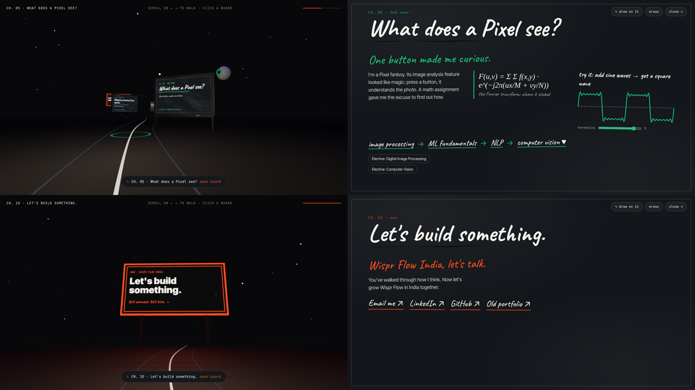

# Dhyey · Walk Through It

An interactive story portfolio built for the Wispr Flow India application.
Tap in, hear the intro, then walk a dark 3D path where every stop is a chalkboard you can open, read, play with and draw on.



[](https://codespaces.new/DhyeyShekhaliya/dhyey-wf-portfolio)

## The experience

1. **Gate:** black screen, "headphones on · tap to enter" (browsers need a tap before sound can play).
2. **Intro:** fades to white; the voiceover plays with word-by-word captions over the title music.
3. **Circle reveal:** on "Come with me", a circle opens and the page goes dark.
4. **3D walk:** first-person path with a chalkboard at each life stop. Scroll or use ← → to walk; scrolling glides to the nearest stop.
5. **Whiteboards:** click a board to open it full screen: chalk diagrams, flip cards, a Fourier demo, links, and a "draw on it" mode.
6. **Billboard:** "Let's build something" with contact links.

## Run it

**In the cloud (no setup):** click *Open in GitHub Codespaces* above. It installs everything and opens the site in a preview tab.

**Locally:**

```bash
npm install
npm run dev
```

Then open http://localhost:3000. Add `?auto` to the URL for a hands-free tour (used to record the preview video).

## Deploy on Vercel

1. Go to [vercel.com/new](https://vercel.com/new) and import this repository.
2. Keep the defaults (Vercel detects Next.js) and click **Deploy**.
3. In the project's **Settings → Domains**, add `dhyeyyy.in`.

After that, every push to `main` redeploys, and every pull request gets its own preview link.

## Edit content

| What | Where |
| --- | --- |
| Board content for every stop (text, lists, diagrams, links, photos) | `lib/stops.js` |
| Intro lines, timings, music and voice settings | top of `lib/intro.js` |
| 3D world (path, boards, props, billboard) | `lib/world.js` |
| Whiteboard behaviour (flip cards, drawing, Fourier demo) | `lib/board.js` |
| Styles | `app/globals.css` |
| Audio / photos | `public/audio/`, `public/img/` |

## Stack

Next.js (App Router), Three.js, GSAP. The whole experience runs client-side from `app/page.js`.

## Audio

- `public/audio/bg.mp3`, `bg2.mp3`: title song clips (intro only)
- `public/audio/voice.mp3`: intro voiceover (a generated stand-in until the real recording replaces it)
- `public/audio/ambient.mp3`: an original slow ambient loop generated for this project
